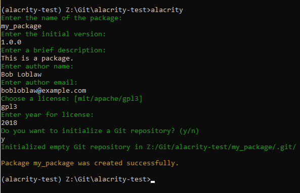

# 
Alacrity

## Note: you might be looking for [Alacritty](https://github.com/alacritty/alacritty) (the terminal emulator), this project was named similarly by coincidence.

Quickstarts your Python project with a single handy command.

## Installation

`pip install alacrity`

## Running Alacrity

To run alacrity, use:

`alacrity <package_name>`

To display all the options, use:

`alacrity -h`

Answer some questions interactively, and poof, your package structure is ready.
Based on the [sample Python package](https://github.com/kennethreitz/samplemod) structure by Kenneth Reitz.

## Features
 - Customized setup.py file
 - Automatic git repository initialization
 - Automatic virtual environment setup
 - Automatic Sphinx docs initialization
 - Easily extensible workflow for custom install steps 

## Platforms
 - Windows (and Cygwin)
 - Linux
 - Android (Termux)

## Testing
 - To run the built-in tests, run `tox` in the project root
 - To add custom testing, edit `tox.ini`
